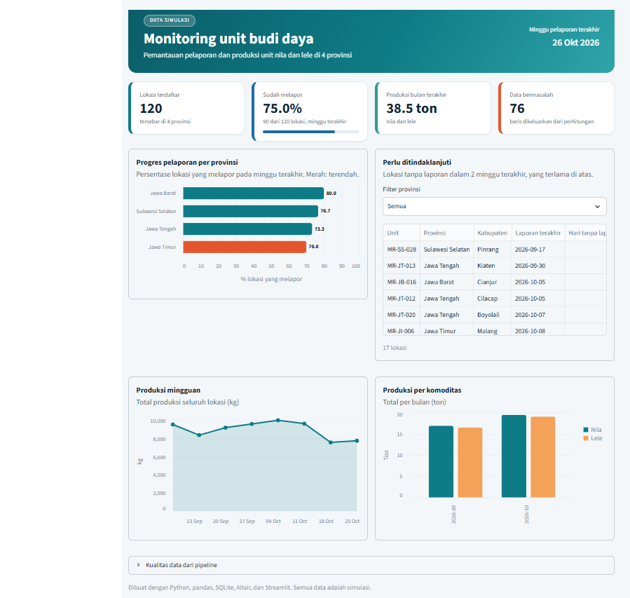

# Monitoring Unit Budidaya

Pipeline data dan dashboard untuk memantau pelaporan dan produksi unit budidaya ikan nila dan lele di empat provinsi. Project ini mensimulasikan masalah yang umum muncul saat data dikumpulkan dari banyak daerah: format laporan berbeda-beda, data kosong, duplikat, dan angka tidak wajar. Data tersebut digabung, dibersihkan, divalidasi, disimpan di database, lalu ditampilkan dalam dashboard.

**[Buka dashboard](https://monitoring-budidaya-cepk2nbnx5dtncoixs8bvu.streamlit.app/)**

> Seluruh data dalam project ini adalah **data simulasi** yang dibuat dengan script, bukan data resmi atau data operasional instansi mana pun.



## Ringkasan

| | |
|---|---|
| Unit terdaftar | 120 unit di 4 provinsi (Jawa Barat, Jawa Tengah, Jawa Timur, Sulawesi Selatan) |
| Sumber data | 4 file dengan format berbeda (2 Excel, 2 CSV) |
| Baris dibaca | 866 |
| Lolos validasi | 790 (91,2%) |
| Dicatat sebagai bermasalah | 76 (8,8%) |
| Teknologi | Python, pandas, SQLite, SQL, Altair, Streamlit |

## Alur data

```
Data mentah dari daerah (Excel/CSV, format berbeda-beda)
        |
        v
Pipeline pembersihan dan validasi (pandas)  ----> Log data bermasalah
        |
        v
Database SQLite (tabel, foreign key, view)
        |
        v
Query SQL rekap  ---->  Dashboard Streamlit
```

### 1. Data mentah yang sengaja berantakan

`pipeline/generate_data.py` membuat empat file laporan dengan format yang berbeda untuk meniru kondisi nyata:

| Sumber | Format | Tanggal | Satuan produksi | Keunikan |
|---|---|---|---|---|
| Jawa Barat | Excel | `26/10/2026` | kg | Nama kolom berbahasa Indonesia |
| Jawa Tengah | CSV | `2026-10-26` | **ton** | Nama kolom berbeda |
| Jawa Timur | Excel | `26 Okt 2026` | kg | Huruf besar-kecil dan spasi tidak konsisten |
| Sulawesi Selatan | CSV | `26-10-26` | kg | Pemisah `;`, desimal koma, istilah status berbeda |

Ke dalam data juga disisipkan duplikat, sel kosong, angka tidak wajar, dan unit yang tidak terdaftar.

### 2. Pembersihan dan validasi

`pipeline/clean_data.py` menyeragamkan nama kolom, format tanggal, satuan (ton menjadi kg), dan penulisan teks, lalu menerapkan delapan aturan validasi:

| Aturan | Jumlah baris |
|---|---|
| Duplikat | 24 |
| Produksi kosong | 16 |
| Unit tidak dikenal (tidak ada di data master) | 12 |
| Produksi di luar batas (negatif atau di atas 500 kg per laporan) | 9 |
| Tanggal kosong atau tidak valid | 8 |
| Komoditas kosong | 8 |
| Komoditas berbeda dengan data master | 0 |
| Status tidak dikenal | 0 |

Satu baris bisa gagal lebih dari satu aturan. Baris yang gagal **tidak dibuang diam-diam**: semuanya dicatat di `data/processed/data_bermasalah.csv` lengkap dengan file asal, nomor baris, dan alasannya, sehingga bisa ditelusuri dan diperbaiki di sumbernya.

### 3. Database

`pipeline/load_db.py` memuat data bersih ke SQLite dengan skema berikut:

- `lokasi`: daftar resmi unit (primary key `unit_id`)
- `laporan`: laporan bersih, dengan foreign key ke `lokasi`, aturan `UNIQUE (unit_id, tanggal)`, dan `CHECK` untuk status serta produksi tidak negatif
- `masalah_data`: log baris yang gagal validasi
- `v_laporan`: view yang menggabungkan laporan dan lokasi, serta menghitung minggu pelaporan

Aturan di tingkat database menjadi lapisan pengaman kedua: data yang lolos dari pipeline tapi melanggar aturan akan ditolak oleh database.

### 4. Query dan dashboard

Enam query rekap ada di `sql/queries.sql` (ringkasan, progres per provinsi, produksi per komoditas, lokasi yang belum melapor, tren mingguan, kualitas data per sumber). Dashboard memakai query yang sama, jadi angka di dashboard selalu bisa dicek ulang lewat SQL.

Dashboard menampilkan:
- Empat indikator utama: lokasi terdaftar, persentase sudah melapor, produksi bulan terakhir, dan data bermasalah
- Progres pelaporan per provinsi
- Daftar lokasi tanpa laporan dalam 2 minggu terakhir, dengan filter provinsi dan jumlah hari tanpa laporan
- Tren produksi mingguan dan produksi per komoditas
- Ringkasan kualitas data dari pipeline

## Keputusan desain dan asumsi

- **Laporan yang tidak valid tidak dihitung sebagai progres.** Unit yang laporannya gagal validasi bisa tampak "belum melapor" sampai datanya diperbaiki. Ini disengaja agar data yang meragukan tidak mengangkat angka pelaporan.
- **Batas 500 kg per laporan adalah asumsi simulasi**, bukan standar resmi. Nilainya bisa diubah lewat `MAKS_PRODUKSI_KG` di `pipeline/clean_data.py`.
- **Duplikat hanya mencakup baris yang kembar persis.** Dua laporan berbeda untuk unit dan tanggal yang sama belum dideteksi sebagai konflik (lihat rencana pengembangan).
- **Data dibuat deterministik** (`random.seed(42)`), sehingga hasilnya sama setiap kali dijalankan.

## Menjalankan secara lokal

Prasyarat: Python 3.11 atau lebih baru.

```bash
git clone https://github.com/AdindaClaraPutriMaharani/monitoring-budidaya.git
cd monitoring-budidaya

python -m venv .venv
.venv\Scripts\Activate.ps1        # Windows PowerShell
pip install -r requirements.txt

streamlit run dashboard/app.py
```

Kalau `data/monitoring.db` belum ada, dashboard menjalankan pipeline sendiri. Pipeline juga bisa dijalankan satu per satu:

```bash
python pipeline/generate_data.py   # membuat data mentah dan data master
python pipeline/clean_data.py      # membersihkan dan memvalidasi
python pipeline/load_db.py         # memuat ke SQLite
python pipeline/run_queries.py     # menampilkan hasil query di terminal
```

## Struktur project

```
monitoring-budidaya/
├── .streamlit/config.toml     # tema dashboard
├── dashboard/app.py           # dashboard Streamlit
├── data/
│   ├── raw/                   # 4 file laporan simulasi (format berbeda)
│   └── reference/             # daftar unit resmi (data master)
├── docs/                      # tangkapan layar untuk README
├── pipeline/
│   ├── generate_data.py       # pembuat data simulasi
│   ├── clean_data.py          # pembersihan dan validasi
│   ├── load_db.py             # pemuatan ke SQLite
│   └── run_queries.py         # menjalankan query di sql/queries.sql
├── sql/queries.sql            # query rekap
├── requirements.txt
└── README.md
```

`data/processed/` dan `data/monitoring.db` dibuat otomatis saat pipeline dijalankan, sehingga tidak disertakan di repository.

## Deployment

Dashboard di-deploy di Streamlit Community Cloud (repository `AdindaClaraPutriMaharani/monitoring-budidaya`, branch `main`, file utama `dashboard/app.py`, Python 3.12). Aplikasi gratis akan "tidur" jika lama tidak dibuka, sehingga pembukaan pertama bisa memerlukan beberapa saat.

## Rencana pengembangan

- [ ] Laporan mingguan otomatis dalam format Excel atau PDF
- [ ] Deteksi konflik: dua laporan berbeda untuk unit dan tanggal yang sama
- [ ] Peta sebaran unit per kabupaten
- [ ] Uji otomatis (pytest) untuk aturan validasi
- [ ] Migrasi ke PostgreSQL

## Kredit

Dibuat oleh Adinda Clara Putri Maharani sebagai project pengolahan dan visualisasi data dengan Python, pandas, SQLite, dan Streamlit. Serta dibantu Claude AI <3
